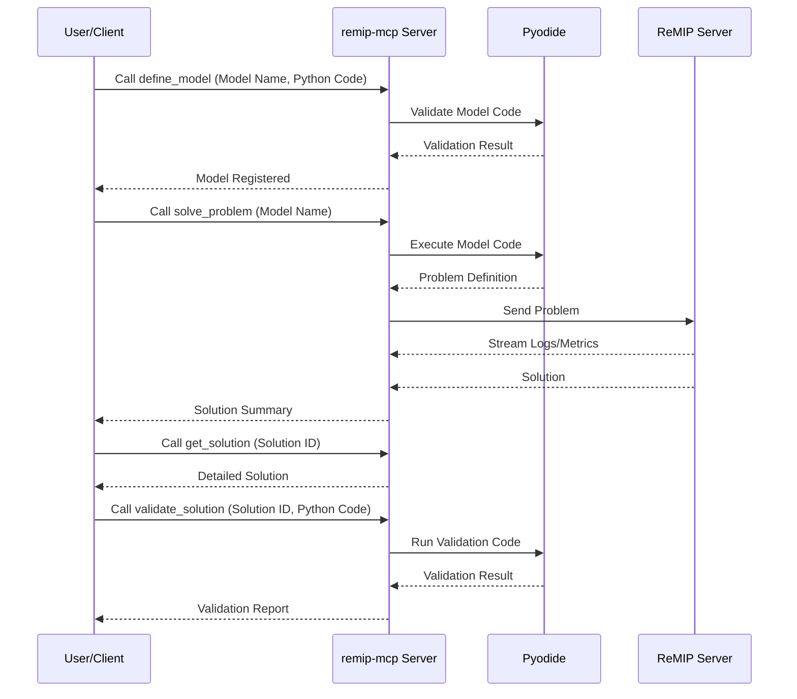

# ReMIP MCP Server

> 🚀 A powerful Model Context Protocol (MCP) server for solving Mixed-Integer Programming (MIP) problems with Pyodide and ReMIP.

[](https://github.com/ohtaman/remip-mcp/actions/workflows/ci.yml)

---

This project provides a service for modeling and solving Mixed-Integer Programming (MIP) problems. It is designed to be used as a tool within a larger system that follows the Model Context Protocol (MCP).

## 💡 What is this?

This is a server that gives you tools to solve complex optimization problems. You can define optimization models using Python's `pulp` library, solve them with [ReMIP Server](https://github.com/ohtaman/remip), and validate the results. The server handles the complicated parts of setting up the problem, communicating with the solver, and managing your models and solutions.

It's useful for anyone who needs to solve resource allocation, scheduling, or other optimization tasks without wanting to build the entire solving pipeline themselves. 


---

## ⚡ Quick Start

This `remip-mcp` server exposes its tools via the Model Context Protocol. Clients can connect to this server to utilize its MIP solving capabilities. While the exact connection mechanism depends on the client application, a client might use a configuration similar to the following to define how it connects to and manages this server:

```json
{
  "mcpServers": {
    "remip-mcp": {
      "command": "npx",
      "args": [
        "-y",
        "github:ohtaman/remip-mcp",
        "--start-remip-server"
      ]
    }
  }
}
```

*Note: This JSON is an example of a client-side configuration and is not processed by this `remip-mcp` server directly. It illustrates how a client might define the command to launch or manage this server.*

> **Note:** The `--start-remip-server` option is important because `remip-mcp` itself does not include a solver. Instead, it requires a connection to an external ReMIP server to perform the actual optimization tasks. By enabling this option, the server will automatically launch and connect to a ReMIP backend as needed, ensuring that your optimization problems can be solved seamlessly.


### Command Line Arguments

The `remip-mcp` server can be configured using the following command-line arguments when run directly (e.g., via `node dist/index.js` or `npx ...`).

*   **`--http`** (boolean)
    *   Enables the HTTP transport for the MCP server. When enabled, the server will listen for MCP requests over HTTP.
    *   Default: `false`
*   **`--port <number>`** (number)
    *   Specifies the port for the HTTP transport. This argument is only relevant when `--http` is enabled.
    *   Default: `8080`
*   **`--start-remip-server`** (boolean)
    *   If set, the `remip-mcp` server will attempt to start a local ReMIP backend server as a child process.
    *   Default: `false`
*   **`--remip-source-uri <string>`** (string)
    *   Specifies the source URI for the ReMIP server to be started. This is used when `--start-remip-server` is true.
    *   Default: `github:ohtaman/remip-server`
*   **`--remip-host <string>`** (string)
    *   Specifies the host of the ReMIP server that `remip-mcp` should connect to.
    *   Default: `localhost`
*   **`--remip-port <number>`** (number)
    *   Specifies the port of the ReMIP server that `remip-mcp` should connect to.
    *   Default: `8081`
*   **`--pyodide-packages <string[]>`** (array of strings)
    *   Provides a comma-separated list of additional Pyodide packages (e.g., `numpy,pandas`) to be installed and available in the Pyodide environment.
    *   Default: `[]`

## ✨ Core Features

This server provides seven main tools for a complete optimization workflow:

*   **`define_model`**: 📝 Defines a reusable optimization model template using Python's `pulp` library. Models can be saved and reused across multiple solving sessions.
*   **`solve_problem`**: ⚙️ Executes an optimization using a pre-defined model. It streams live updates, so you can see the solver's progress in real-time.
*   **`get_solution`**: 📊 Retrieves detailed solution information including variable values, objective value, and solver statistics.
*   **`validate_solution`**: ✅ Validates a solution against problem constraints using custom Python validation code.
*   **`list_models`**: 📋 Lists all registered models in the current session with their metadata.
*   **`get_model`**: 🔍 Retrieves the source code and details of a specific registered model.
*   **`list_solutions`**: 📈 Lists summaries of all solutions generated in the current session.

## 🧠 How It Works

The server is built with Node.js and uses a technology called **Pyodide** to safely run your Python code without you needing to install Python yourself.



Here's a step-by-step breakdown of the process:

1.  You call the `define_model` tool with your optimization model written in Python and a model name.
2.  The server validates your code and stores the model for reuse.
3.  You call the `solve_problem` tool with the model name to execute the optimization.
4.  The server runs your model code, creates a problem definition, and sends it to a **ReMIP (Remote MIP) solver**.
5.  As the solver works, it sends back logs and progress metrics, which you receive as notifications.
6.  Once finished, you get a solution summary with a unique solution ID.
7.  You can use `get_solution` to retrieve detailed solution information.
8.  You can use `validate_solution` to run custom validation code against the solution.
9.  Models and solutions are managed per session and can be listed using `list_models` and `list_solutions`.

---

## 👨‍💻 For Developers

This section contains information for developers who want to contribute to or run this project locally.

### Building and Running 🛠️

**Prerequisites:**

*   Node.js
*   npm

**Installation:**

```bash
npm install
```

**Linting and Formatting:**

```bash
# Run the linter
npm run lint

# Automatically fix linting and formatting issues
npm run lint:fix
```

**Running the development server:**

This command starts the server with auto-reloading when source files change.

```bash
npm run dev
```

**Running the production server:**
First, build the TypeScript code:

```bash
npm run build
```

Then, start the server:

```bash
npm start
```

## 📄 License

This project is licensed under the Apache-2.0 License - see the [LICENSE](LICENSE) file for details.
